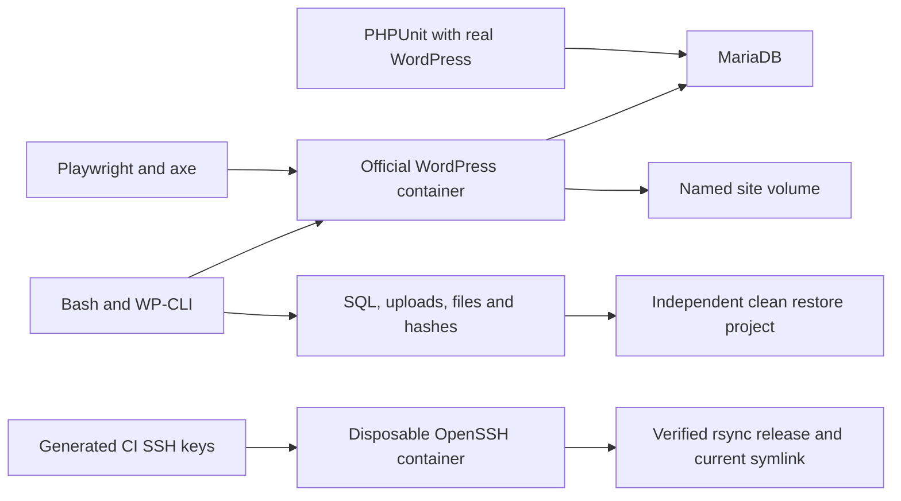

# WordPress maintenance lab

A disposable lab for maintaining a synthetic WordPress site. It includes a custom child theme, a PHP plugin with shortcodes and settings, scripted setup and updates, full rollback, SQL and upload backups, a tested clean restore, browser checks, and an SSH/rsync deployment exercise.

Everything runs in GitHub Actions. No additional accounts, API keys, PC installs, local Docker, real server, or hosting are required. Docker Compose runs only on the GitHub runner for this task. The site represents a fictional German business, Nordlicht Reparaturatelier. All site content and form messages are synthetic.

## Architecture



## Three commands

CI executes these workflows automatically. The commands also work in an already prepared Linux environment with Docker Compose, WP-CLI's container image, Node dependencies, and Playwright installed. Running them locally is optional.

Install and configure the complete synthetic site:

```sh
bash scripts/setup.sh
```

Create a snapshot, update core and its database, update the demo plugin and parent theme, and check the site:

```sh
bash scripts/update.sh
```

Restore a verified backup into independent, clean volumes and test it:

```sh
bash scripts/test-restore.sh artifacts/backups/verified-release
```

The last command uses a backup produced by CI's backup step. `scripts/backup.sh NAME` exports another backup. `scripts/list-updates.sh` lists available core, plugin, and theme updates. `scripts/checks.sh PHASE` runs the browser checks and PHP log check. These scripts print their action and return a nonzero status when a required action fails.

## Site and custom code

The child theme `site/themes/nordlicht-child` extends Twenty Twenty-One. It adds custom HTML templates, CSS, an accessible skip link, a simple JavaScript disclosure, and responsive German page layouts. The parent theme remains independently updatable.

The plugin `site/plugins/nordlicht-lab` provides `[nordlicht_kontakt]`, `[nordlicht_formular]`, and a Settings API page under Settings. It sanitizes settings and submitted data, escapes displayed values, and protects contact submission with a WordPress nonce. The lab contact form stores one synthetic message in a WordPress option. It sends no mail and uses no external service. Only the local lab administrator can edit settings.

Setup creates four pages, two posts, a primary menu, synthetic contact settings, and a test upload. It uses the official WordPress Apache and CLI images plus MariaDB 11.4. Ports are bound to runner loopback addresses. The lab credentials in `lab.env` and Compose are deliberately public and disposable; they are not credentials for a real site. Setup retains an already installed site's content rather than reseeding it.

## Update and rollback steps

The demo deliberately starts on an older core patch release and an older copy of the inactive Hello Dolly plugin. Versions are configured in `lab.env` and checked against the [official WordPress release archive](https://wordpress.org/download/releases/) and [official plugin API](https://api.wordpress.org/plugins/info/1.2/?action=plugin_information&request%5Bslug%5D=hello-dolly). The old software is used only inside the disposable runner lab. The custom plugin is active; Hello Dolly is installed only to demonstrate updates.

The update script takes a local lock, checks the current site, lists available updates, and creates a complete snapshot. It enables maintenance mode, updates WordPress core, runs the database upgrade, updates Hello Dolly, and then updates the parent theme. It disables maintenance mode, restarts Apache to clear cached PHP code, and runs the full browser suite and PHP log check.

If an update or check fails, the error handler restores the snapshot's application files, database and uploads, then checks the restored site with the browser suite. A verified rollback returns `20`, so the failed update is still reported as a failure. A failed rollback returns `21`. Incorrect arguments return `2`; a concurrent update lock returns `3`. Other failures retain a nonzero command status. The snapshot must complete before any update begins.

CI deliberately injects a fatal PHP error after updating, expects return code `20`, compares pre-update and post-rollback versions and content, and checks the restored old site. It then runs a second update without the fault and checks the updated site. No successful recovery is inferred from a log message alone.

## Backup and restore steps

A backup contains a SQL export, an uploads archive, a separate archive of the full WordPress application, exact versions, a canonical content inventory, per-upload hashes, and SHA-256 checksums. Maintenance mode limits site changes during the snapshot. The application archive lets a rollback restore core, themes, and plugins as well as the database.

Clean restore creates a second Compose project, `wmlrestore`, with new database and site volumes and separate ports. It verifies the archive checksums, restores the files and uploads, imports SQL, adjusts only the site URL options, and compares post/page counts, a canonical content hash, and the upload hash list. The original source instance remains in place. A shell test checks that the source and restore volumes differ, that the source content is unchanged, and that the full restored browser suite passes. The content hash covers ids, type, status, slug, title, content, excerpt, parent, and menu order for posts and pages; it is not a hash of volatile WordPress tables.

Only named lab projects with the `wml` prefix are accepted. Clean restore refuses to delete the source project. In-place rollback requires the snapshot's recorded source project to match the target. The scripts operate on disposable named volumes, not PC folders.

## SSH deployment exercise

`scripts/deploy.sh` uses SSH and rsync to upload only the custom theme and plugin into a new release directory. It checks every transferred file hash before atomically moving a `current` symlink. It uses batch mode, explicit identity keys, and strict host-key verification. The destination and path are validated before they are used in a remote command.

CI builds an OpenSSH container with a restricted `deploy` user. It generates short-lived client and host keys on the runner and constructs known-hosts data from that trusted host key. It checks successful key login, rejected wrong-key login, matching rsync file hashes, and that a rejected deployment leaves the current release unchanged. Password login and root login are disabled. No key is uploaded as an artifact. The container is not a real hosting target, and deployment does not publish anything to the internet.

## Tests and quality

Playwright runs after initial setup, after rollback, after a successful update, and after clean restore. Checks cover the home page, document title, menu links, shortcode output, contact submission and nonce rejection, PHP error text, browser console errors, basic axe accessibility rules, keyboard navigation, JavaScript, and the plugin settings page. Screenshots, traces on failure, HTML reports, and JUnit output are saved per phase. Automated accessibility checks are limited checks, not an accessibility certification.

PHPUnit loads the installed WordPress code against the disposable database and tests the actual plugin functions. It does not replace WordPress APIs with permissive stubs. PHPCS applies the WordPress standard to the child theme and plugin. ShellCheck checks the Bash scripts. The workflow uses Bash with `pipefail`, so logging through `tee` does not turn a failing command into a pass.

## Measured CI results

<!-- CI_METRICS_START -->
| Metric | Measured in CI |
| --- | ---: |
| PHPUnit plugin tests | 16 |
| Distinct Playwright tests | 9 |
| Playwright executions across four phases | 36 |
| Shell scenarios | 6 |
| Distinct test cases | 31 |
| Total test executions | 58 |
| Failures / skipped | 0 / 0 |
<!-- CI_METRICS_END -->

Measured on 5 November 2026 in [CI run 42052861321](https://github.com/hamza2829/wordpress-maintenance-lab/actions/runs/42052861321), commit `fea3a67bd7b6443c38fe0986dba646562e0c0105`. All four browser phases passed nine tests each. Both the maintenance job and quality job passed. The actual [measurement JSON](docs/ci-measurements.json), [restore comparison](docs/restore-proof.json), and [passed shell scenarios](docs/shell-cases.json) are preserved from that run.

That run verified WordPress `7.1.3` to `7.1.4` and Hello Dolly `1.6` to `1.7.2`. Twenty Twenty-One was already current at `2.9`, so it did not change. The custom child theme stayed active. Clean restore matched all three post records and four page records, the uploads, and content SHA-256 `615f4ebb75a630cad5c6865ab5a827637ca0f601db6e598b7a566bf93a14ef32`. The inventory includes every stored post/page status, including drafts, rather than only published content.

`ci/measure.py` counts real JUnit test cases and shell scenarios recorded only after their assertions pass. It avoids counting nested PHPUnit suites twice. Repeated browser executions are shown separately from distinct test cases. The measured version transition and restore content hash are recorded in JSON artifacts. No coverage figure is claimed.

## Artifacts and limitations

The `wordpress-maintenance-results` artifact includes update and rollback logs, backup archives, restore proof, version inventories, browser reports, screenshots, PHPUnit results, deployment file hashes, and test measurements. `wordpress-quality-results` contains PHPCS and ShellCheck logs. All backups contain only lab data and the disposable lab configuration.

This is a local maintenance simulation with synthetic content and no real client site. It does not provide public hosting, email delivery, production secrets, HTTPS termination, DNS, offsite backup storage, backup encryption, traffic handling during maintenance, multisite support, or production deployment approvals. Updates are exercised in a controlled compatibility sequence; there is no universal safe order for every third-party plugin ecosystem. The parent theme and public download services can change, so every CI run verifies actual behavior.

Backups are tested within this lab, not across arbitrary hosting environments. The SSH exercise verifies transfer, authentication, and a release pointer, not a public web-server deployment. The PHP tests write to the disposable lab database and must not be pointed at a real site. There are no claims about real-client availability, security certification, or recovery guarantees.
